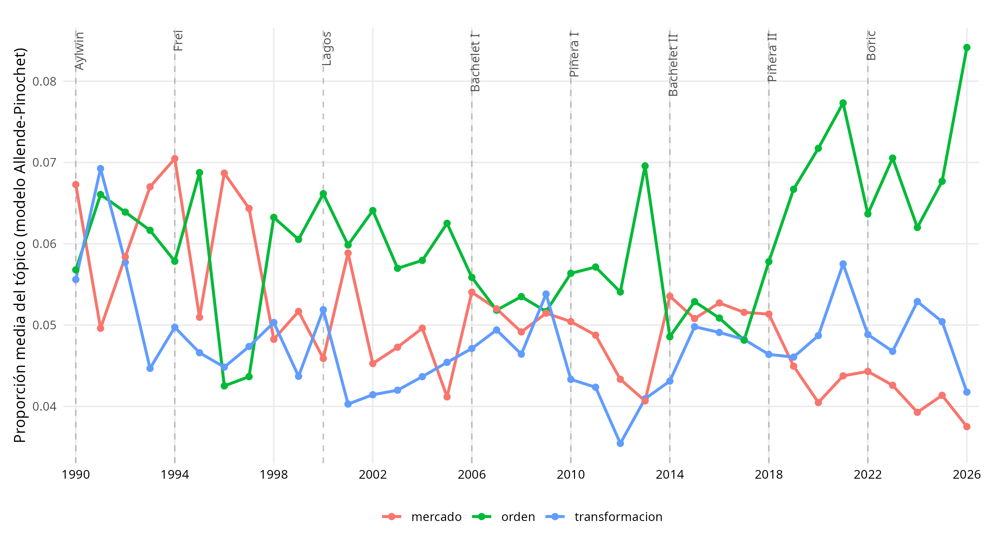
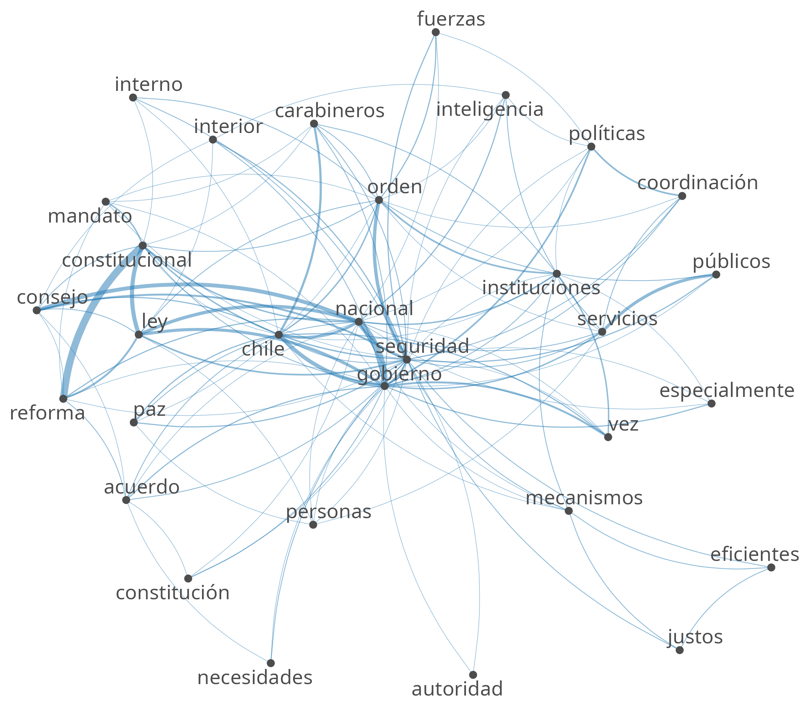
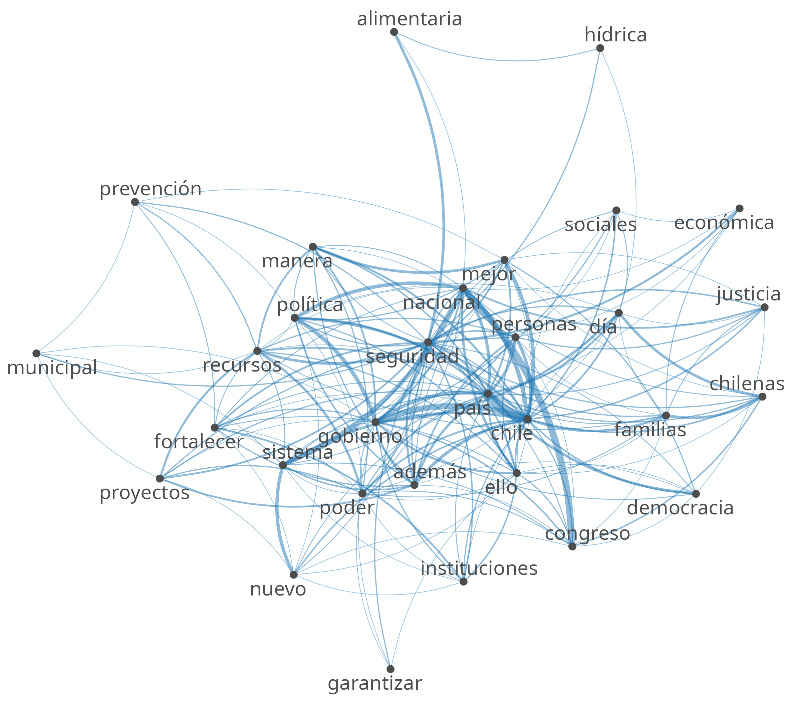

# Parte 1 · Pregunta, hipótesis y semillas

**Pregunta.** ¿Volvió el lenguaje de Allende a las cuentas públicas presidenciales después de 1990?

**Hipótesis 1.** A partir de la vuelta a la democracia, el lenguaje de las cuentas públicas de los presidentes se asimila al de Allende. Esta expectativa se apoya en que los gobiernos posteriores a 1990 retomaron una agenda de reformas sociales, que el discurso de Boric tras su elección en 2021 evocó explícitamente a Allende [VERIFICAR Y CITAR FUENTE], y en [AUTOR, AÑO: lectura del curso sobre el discurso político de la Unidad Popular].

**Hipótesis 2.** La excepción a este giro es el gobierno de Kast, cuya cuenta pública de 2026 enfatiza el orden y la seguridad, en línea con [AUTOR, AÑO: lectura del curso]. Es una hipótesis frágil, porque Kast tiene una sola cuenta (223 párrafos).

**Diccionario.** topicos,diccionario y residual

# Parte 2 · Medición integrada


*Corpus Allende-Pinochet*

| Tópico | Semillas | Descubiertas |
|---|---|---|
| transformacion | gobierno_popular, socialismo, revolucionario, clase, capitalista, socialista, revolución, transformaciones, unidad_popular, explotación, transformación | social, pueblo, régimen, trabajadores |
| orden | orden, patria, fuerzas_armadas, seguridad, autoridades, soberanía, reconstrucción | chile, país, nacional, nación, pasado, primera, progreso, hacia |
| mercado | inversión, inversiones, privado, libertad, privada, empresarios, mercado | sector, sectores, parte, mayor, distribución, ingresos, economía, nacional |

*Cuentas públicas 1990-2026 (modelo propio)*

| Tópico | Semillas | Descubiertas |
|---|---|---|
| transformacion | (ninguna) | años, gobierno, año, hace, país, dos, días, meses, tres, pasado, materia, próximos, primer, primera, cada |
| orden | seguridad, patria, fuerzas_armadas, orden, autoridades, reconstrucción | carabineros, delincuencia, nacional, violencia, víctimas, delitos, prevención, gobierno, instituciones |
| mercado | inversión, privado, modernización, inversiones, libertad, mercados, mercado, iniciativas, empresarios, iniciativa | desarrollo, empresas, sector, economía, energía |

**Resultados por gobierno.** 

| Gobierno | transformacion | orden | mercado | Párrafos |
|---|---|---|---|---|
| Aylwin | 0,054 | 0,058 | 0,062 | 1.556 |
| Frei | 0,046 | 0,056 | 0,062 | 1.691 |
| Lagos | 0,046 | 0,061 | 0,051 | 1.434 |
| Bachelet I | 0,048 | 0,050 | 0,050 | 1.673 |
| Piñera I | 0,045 | 0,055 | 0,045 | 1.088 |
| Bachelet II | 0,048 | 0,051 | 0,050 | 1.679 |
| Piñera II | 0,056 | 0,064 | 0,049 | 851 |
| Boric | 0,050 | 0,060 | 0,046 | 946 |
| Kast | 0,040 | 0,075 | 0,043 | 223 |


{width=90%}


| Gobierno | transformacion | orden | mercado |
|---|---|---|---|
| Aylwin | +0,005 | +0,001 | +0,015 |
| Frei | +0,000 | +0,004 | +0,011 |
| Lagos | +0,004 | +0,014 | +0,000 |
| Bachelet I | +0,001 | −0,002 | +0,005 |
| Piñera I | +0,008 | −0,003 | +0,006 |
| Bachelet II | −0,006 | −0,003 | +0,001 |
| Piñera II | −0,005 | −0,010 | +0,004 |
| Boric | +0,003 | −0,002 | −0,004 |
| Kast | (solo una cuenta) | (solo una cuenta) | (solo una cuenta) |


# Parte 3 · Validación
.

| Tópico | Sí (1) | No (0) | Duda (9) | Precisión |
|---|---|---|---|---|
| transformacion | 1 | 18 | 1 | 5,3% (1/19) |
| orden | 3 | 16 | 1 | 15,8% (3/19) |


# Parte 4 · Coocurrencias


| Puesto | Aylwin | Frec. | Boric | Frec. |
|---|---|---|---|---|
| 1 | orden | 12 | gobierno | 10 |
| 2 | gobierno | 7 | recursos | 9 |
| 3 | consejo | 7 | alimentaria | 9 |
| 4 | ley | 6 | económica | 7 |
| 5 | constitucional | 5 | además | 7 |
| 6 | nacional | 5 | proyectos | 6 |
| 7 | paz | 4 | fortalecer | 6 |
| 8 | fuerzas | 4 | país | 5 |
| 9 | públicos | 4 | personas | 5 |
| 10 | interior | 4 | justicia | 5 |

{width=48%} {width=48%}


# Parte 5 · Interpretación, límites y ética


# Anexo

**Semilla y parámetros.** `set.seed(2026)`; `residual = 15` (robustez: `residual = 8`); paquetes `quanteda` 4.5.1 y `seededlda` 1.4.4.


```r
dic <- dictionary(list(
  transformacion = c("socialis*", "revoluc*", "capitalis*", "explota*", "clase",
                     "clases", "monopol*", "imperialis*", "latifund*", "oligarq*",
                     "liberación", "nacionalización", "transformaci*",
                     "unidad_popular", "gobierno_popular", "área_de_propiedad_social"),
  orden          = c("patria", "orden", "seguridad", "fuerzas_armadas",
                     "junta_de_gobierno", "reconstrucción", "caos", "disciplina",
                     "soberan*", "autoridad*", "subversi*", "marxis*"),
  mercado        = c("mercado*", "privad*", "inversión", "inversiones", "competencia",
                     "eficien*", "iniciativa*", "libertad", "moderniza*",
                     "subsidiari*", "empresarios")))
```

**Expresiones compuestas** usadas en el preprocesamiento: ****poner


**sessionInfo()**

```{r}
#| echo: true
sessionInfo()
```
