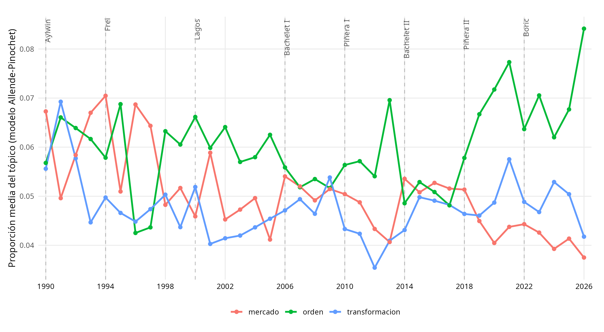
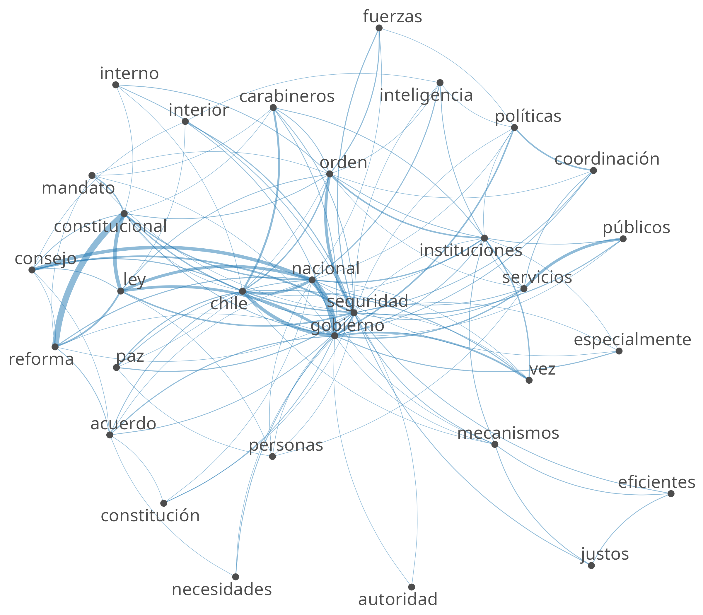
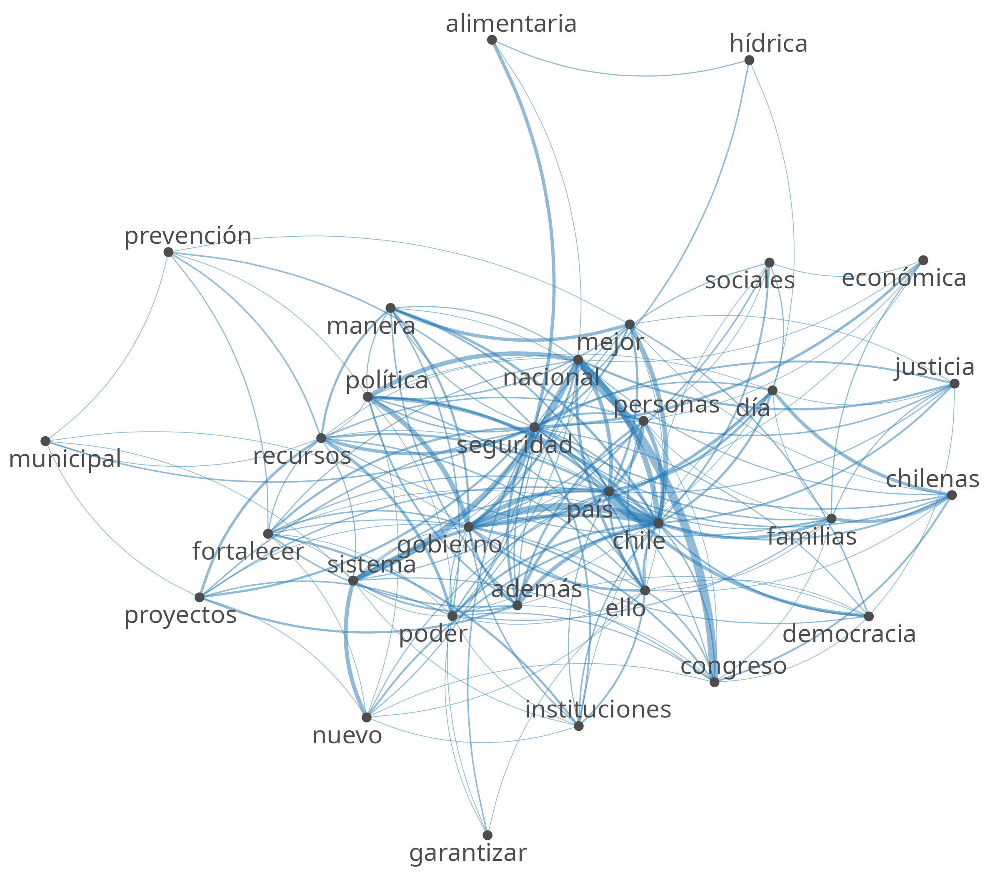

\newpage

```{r}
#| label: setup
#| include: false

library(knitr)
library(kableExtra)
library(dplyr)
library(ggplot2)
library(quanteda)

# Cargar automáticamente todos los archivos .rds de la carpeta tablas/
archivos_tablas <- list.files("tablas", pattern = "\\.rds$", full.names = TRUE)

for (archivo in archivos_tablas) {
  # Extrae el nombre sin ruta ni extensión y asigna el objeto al entorno global
  nombre_objeto <- gsub("\\.rds$", "", basename(archivo))
  assign(nombre_objeto, readRDS(archivo), envir = .GlobalEnv)
}

pred_cuentas <- readRDS("data/pred_cuentas_desde_AP.rds")
corp_par_1990_2026 <- readRDS("data/corp_par_1990_2026.rds")
theta <- pred_cuentas
textos <- as.character(corp_par_1990_2026)[rownames(pred_cuentas)]
```

# Pregunta, hipótesis y semillas

**Pregunta.** ¿Volvió el lenguaje de Allende a las cuentas públicas presidenciales después de 1990?

**Hipótesis 1.** Desde 1990, las cuentas públicas de los presidentes de izquierda y centroizquierda (Aylwin, Frei, Lagos, Bachelet y Boric) se asemejan al lenguaje de Allende. Esto se apoya en que Boric cerró su discurso de la primaria de 2021 citando el mensaje final de Allende (Boric, 2021) y en que el discurso allendista articuló la vía chilena al socialismo (Roldán, 2011), aunque Moulian (1997) advierte que la democracia posdictadura preservó la base económica heredada.

**Hipótesis 2.** Las cuentas de los presidentes de derecha se asemejan al lenguaje de Pinochet, en particular la de Kast, cuya cuenta de 2026 se organizó en torno al orden y la seguridad (Kast, 2026; Masalleras, 2026). Es una hipótesis frágil, pues Kast tiene una sola cuenta (223 párrafos).

**Método y diccionario.** Usamos un modelo de tópicos semillado (seeded LDA), que permite contrastar un constructo teórico con los patrones que descubre el modelo (Hurtado Bodell et al., 2026, pp. 11-12). Empleamos el diccionario de las sesiones 9 y 10 sin modificar palabras, con tres tópicos (`transformacion`, `orden` y `mercado`; ver Anexo). El único cambio fue de preprocesamiento, unimos como expresiones compuestas "unidad popular", "gobierno popular", "junta de gobierno" y "área de propiedad social", porque sin esa unión las semillas multipalabra no existían en la matriz y tenían cero apariciones. Son los términos propios del vocabulario político de 1970-1973 incluidos en el diccionario. La unidad de análisis es el párrafo (se eliminaron los de menos de 10 palabras), con `residual = 15` y semilla 2026.
```{r}
#| tbl-cap: "Diccionario utilizado"

dic <- dictionary(list(
  transformacion = c("socialis*", "revoluc*", "capitalis*", "explota*", "clase",
                     "clases", "monopol*", "imperialis*", "latifund*", "oligarq*",
                     "liberación", "nacionalización", "transformaci*",
                     "unidad_popular", "gobierno_popular", "área_de_propiedad_social"),
  orden          = c("patria", "orden", "seguridad", "fuerzas_armadas",
                     "junta_de_gobierno", "reconstrucción", "caos", "disciplina",
                     "soberan*", "autoridad*", "subversi*", "marxis*"),
  mercado        = c("mercado*", "privad*", "inversión", "inversiones", "competencia",
                     "eficien*", "iniciativa*", "libertad", "moderniza*",
                     "subsidiari*", "empresarios")))
marcos <- names(dic)

# 1. Convertir el diccionario a un data frame colapsando los términos con comas
tab_dic_compacto <- data.frame(
  Marco = names(dic),
  Terminos = sapply(dic, function(x) paste(as.character(x), collapse = ", "))
)

# 2. Renderizar con kableExtra y anchos fijos para que baje de línea ordenadamente
kable(
  tab_dic_compacto,
  col.names = c("Marco Temático", "Términos del Diccionario"),
  row.names = FALSE,
  digits = 3,
  booktabs = TRUE
) |>
  kable_styling(latex_options = c("striped", "hold_position"), font_size = 9) |>
  column_spec(1, width = "3.5cm") |>  # Columna del marco más angosta
  column_spec(2, width = "10.5cm")    # Columna de términos con espacio amplio
```


# Medición integrada

Estimamos dos modelos semillados. El primero es sobre el corpus Allende-Pinochet (1.278 párrafos) y otro sobre las cuentas 1990-2026 (11.156 párrafos). El modelo principal es el de Allende-Pinochet proyectado sobre las cuentas, porque así los tópicos quedan definidos por el vocabulario de la época de Allende, que es lo que pregunta la hipótesis 1. Al proyectar se perdieron 15 párrafos (0,13%). El modelo estimado directamente en las cuentas se usa solo como contraste.


```{r}
#| label: tbl-palabras-ap
#| tbl-cap: "Palabras semilla y descubiertas por el modelo (Modelo Allende-Pinochet)"
kable(
  pal_prob_ap,
  col.names = c("Tópico", "Semillas", "Descubiertas"),
  booktabs = TRUE,
  digits = 3,
  linesep = "\\addlinespace[1em]"
) |>
  kable_styling(
    latex_options = c("striped", "hold_position"),
    stripe_color = "gray!10",
    font_size = 9
  ) |>
  column_spec(1, width = "3cm") |>
  column_spec(2, width = "6.5cm") |>
  column_spec(3, width = "6.5cm") 
```


```{r}
#| label: tbl-palabras-90
#| tbl-cap: "Palabras semilla y descubiertas por el modelo (Modelo de cuentas publicas 1990-2026)"

kable(
  pal_prob_90_26,
  col.names = c("Tópico", "Semillas", "Descubiertas"),
  booktabs = TRUE,
  digits = 3,
  linesep = "\\addlinespace[1em]"
) |>
  kable_styling(latex_options = c("striped", "hold_position"),
    stripe_color = "gray!10", # Mixes 10% black with 90% white
font_size = 9) |>
  column_spec(1, width = "3cm") |>
  column_spec(2, width = "6.5cm") |>
  column_spec(3, width = "6.5cm")
```

En Allende-Pinochet, `transformacion` confirma el concepto, 11 de sus 15 palabras son semillas y las descubiertas (pueblo, régimen, trabajadores) son coherentes con él. Por otro lado, `orden` lo confirma solo en parte, porque mezcla 7 semillas con palabras genéricas (chile, país, nacional). También `mercado` confirma y amplía con vocabulario económico (distribución, ingresos, economía). En las cuentas, `transformacion` desmiente el concepto, ninguna de sus 15 palabras más probables es una semilla, y el tópico reúne vocabulario educativo (educación, calidad, jóvenes, escuelas, estudiantes), por lo que es un tópico temático y no mide ideología. Las semillas existen en las cuentas, pero son escasas (unas 230 apariciones, por ejemplo transformaciones, transformación y revolución), y el modelo no logró anclar el tópico en ellas. Por otro lado, `orden` cambia de sentido, ya que, pasa del orden patriótico-militar a la seguridad pública (carabineros, delincuencia, violencia, delitos, víctimas). Por último, `mercado` confirma y amplía hacia desarrollo, empresas y energía.


```{r}
#| label: tbl-gob-proy
#| tbl-cap: "Modelo de cuentas públicas 1990-2026 proyectando los tópicos del modelo anterior"
#| echo: false

kable(
  tab_gob_proy, 
  digits = 3, 
  booktabs = TRUE
) |>
  kable_styling(
    latex_options = c("striped", "hold_position"),
    stripe_color = "gray!10",
    font_size = 9,
    position = "center"
  )
```

```{r}
#| label: tbl-primeras
#| tbl-cap: "Primera cuenta de cada mandato frente al promedio del gobierno"

orden_gob <- c("Aylwin", "Frei", "Lagos", "Bachelet I", "Piñera I",
               "Bachelet II", "Piñera II", "Boric", "Kast")

df_theta <- as.data.frame(theta[, c("transformacion", "orden", "mercado")])
df_theta$gobierno <- sub("_.*", "", rownames(theta))
df_theta$anio <- as.integer(sub(".*_([0-9]{4}).*", "\\1", rownames(theta)))

prom_gob <- df_theta |>
  group_by(gobierno) |>
  summarise(across(c(transformacion, orden, mercado), mean), .groups = "drop")

primeras <- df_theta |>
  group_by(gobierno) |>
  filter(anio == min(anio)) |>
  summarise(anio = first(anio),
            across(c(transformacion, orden, mercado), mean), .groups = "drop")

comparacion <- left_join(primeras, prom_gob, by = "gobierno",
                         suffix = c("_p", "_g")) |>
  mutate(gobierno = factor(gobierno, levels = orden_gob)) |>
  arrange(gobierno) |>
  select(gobierno, anio, transformacion_p, transformacion_g,
         orden_p, orden_g, mercado_p, mercado_g)

kable(
  comparacion,
  digits = 3,
  booktabs = TRUE,
  col.names = c("Gobierno", "Año", "1ª", "Gob.", "1ª", "Gob.", "1ª", "Gob.")
) |>
  add_header_above(c(" " = 2, "Transformación" = 2, "Orden" = 2, "Mercado" = 2)) |>
  kable_styling(latex_options = c("striped", "hold_position"),
                stripe_color = "gray!10", font_size = 9)
```


{width=90%}


# Validación

## Párrafos más típicos

```{r}
#| label: tipicos
#| results: asis

# theta: matriz de documentos x tópicos del modelo proyectado
# textos: vector con el texto de cada párrafo (mismo orden)
top5 <- order(theta[, "orden"], decreasing = TRUE)[1:5]
for (i in top5) {
  cat("- ", substr(textos[i], 1, 350), "...\n\n", sep = "")
}
```

Los cinco párrafos más típicos de `orden` no corresponden a discursos sobre seguridad pública. Cuatro son fórmulas protocolares de apertura (saludos a las autoridades y la referencia al mandato constitucional de dar cuenta al país) o citas del artículo 24 de la Constitución, donde "orden público" aparece como atribución presidencial. Solo uno trata de Carabineros y la Policía de Investigaciones, y lo hace en clave jurídico-institucional. Esto indica que el tópico captura, además del vocabulario de seguridad, el lenguaje formal del Estado, lo que coincide con la presencia de palabras genéricas (chile, país, nacional) entre sus términos más probables y ayuda a explicar la baja precisión de la codificación manual (15,8%).

## Codificación manual

Codificamos a mano 20 párrafos (1 = sí, 0 = no, 9 = duda). El resultado de la Tabla @tbl-validacion es bajo, ya que solo 1 de 19 párrafos de `transformacion` (5,3%) y 3 de 19 de `orden` (15,8%) expresan el concepto. Esto indica que, en las cuentas públicas, los tópicos no miden ideología como la define el diccionario. `transformacion` reúne sobre todo vocabulario educativo y de políticas sectoriales, y `orden` se desplazó hacia la seguridad pública. Palabras como "clase" o "transformación" aparecen en usos que no son ideológicos (por ejemplo, la transformación del Estado para la acción climática). Por eso, los resultados de la Parte 2 deben leerse como medidas de vocabulario temático y no como evidencia directa de ideología.

| Tópico | Sí (1) | No (0) | Duda (9) | Precisión |
|---|---|---|---|---|
| transformacion | 1 | 18 | 1 | 5,3% (1/19) |
| orden | 3 | 16 | 1 | 15,8% (3/19) |

: Resultados de la codificación manual {#tbl-validacion}

## Palabra ambigua en contexto

```{r}
#| label: tbl-kwic-orden
#| tbl-cap: "Ocho líneas de kwic() para orden"

kw <- kwic(tokens(corp_par_1990_2026), pattern = "orden", window = 8)
set.seed(2026)
kw_muestra <- kw[sample(nrow(kw), 8), ]

kable(
  data.frame(Gobierno = kw_muestra$docname,
             Antes = kw_muestra$pre,
             Palabra = kw_muestra$keyword,
             Después = kw_muestra$post),
  booktabs = TRUE, font_size = 8
) |>
  kable_styling(latex_options = c("striped", "hold_position"), font_size = 8)
```

En las ocho líneas, "orden" aparece en cuatro sentidos y solo uno corresponde al concepto de seguridad que busca el diccionario. Dos casos son una expresión de magnitud ("del orden de 100 millones de dólares", "del orden de catorce veces"), sin contenido político. Dos son parte del nombre de las instituciones policiales ("Fuerzas Armadas y de Orden y Seguridad"). Tres se refieren a un orden institucional o internacional ("orden internacional basado en reglas", "orden común", "orden legislativo"). Solo la línea de Piñera II (2021), "la defensa del orden público, la seguridad ciudadana", expresa el sentido de seguridad pública. Por lo tanto, contar apariciones de "orden" sobreestima el concepto, lo que concuerda con la baja precisión de la codificación manual (15,8%).

## Robustez

Cambiamos una sola decisión, `residual` de 15 a 8. La posición de Kast se mantiene, sigue primero en `orden` y último en `mercado` (@tbl-robustez). En cambio, el orden del resto de los gobiernos no es estable. En `transformacion` solo Lagos y Bachelet I conservan su lugar, y hay saltos grandes (Piñera II pasa del 7.º al 1.º lugar y Bachelet II del 1.º al 4.º). En `orden`, Aylwin cae del 3.º al 9.º lugar. Por lo tanto, la conclusión sobre Kast es robusta a este cambio, pero las diferencias entre los demás gobiernos son pequeñas y sensibles a la especificación del modelo, y no deben interpretarse como un ordenamiento firme.

```{r}
#| label: tbl-robustez
#| tbl-cap: "Comparación de posiciones del modelo original contra el de 8 residuos"

kable(
  tabla_robustez,
  col.names = c("Gobierno", "Base", "Nuevo", "Base", "Nuevo.", "Base", "Nuevo."),
  booktabs = TRUE,
  align = c("l", rep("c", 6)),
  linesep = ""
) |>
  add_header_above(c(" " = 1, "Transformación" = 2, "Orden" = 2, "Mercado" = 2)) |>
  kable_styling(
    latex_options = c("striped", "hold_position"),
    stripe_color = "gray!10",
    font_size = 9
  ) |>
  column_spec(1, width = "3.2cm") |>
  column_spec(2:7, width = "1.8cm")
```

# Coocurrencias

{width=48%} {width=48%}

```{r}
#| label: tbl-vecinos-seguridad
#| tbl-cap: "Principales vecinos de seguridad en Aylwin y Boric"

vecinos <- function(gob, n = 10) {
  toks <- tokens(corpus_subset(corp_par_1990_2026, gobierno == gob),
                 remove_punct = TRUE) |>
    tokens_tolower() |> tokens_remove(stopwords("es"))
  f <- fcm(toks, context = "window", window = 5)
  v <- f[, "seguridad"]
  head(sort(setNames(as.vector(v), rownames(v)), decreasing = TRUE), n)
}

va <- vecinos("Aylwin"); vb <- vecinos("Boric")
kable(
  data.frame(Puesto = 1:10,
             Aylwin = names(va), Frec_A = as.integer(va),
             Boric = names(vb), Frec_B = as.integer(vb)),
  col.names = c("Puesto", "Aylwin", "Frec.", "Boric", "Frec."),
  booktabs = TRUE
) |>
  kable_styling(latex_options = c("striped", "hold_position"), font_size = 9)
```

Con Aylwin, "seguridad" se asocia sobre todo a "orden", "ley", "constitucional" y "fuerzas", es decir, a un marco jurídico-institucional y de defensa. Con Boric, el vecino principal es "pública", acompañado de "social", "personas", "instituciones" y "justicia", lo que sugiere un sentido más amplio, ligado a las personas y a la política social, aunque "social" podría ser también seguridad social. Así, la palabra mantiene su asociación con lo público, pero pierde el vocabulario de orden y fuerzas de 1990-1994. Las frecuencias son bajas (4 a 19), por lo que la lectura es exploratoria.

# Interpretación, límites y ética

No contamos evidencia de que el lenguaje de Allende haya vuelto a las cuentas públicas después de 1990. El tópico transformación se mantiene entre 0,041 y 0,055 en todos los gobiernos (Tabla 4), siempre por debajo del 0,073 de Allende (Tabla 8). Boric (0,049) no se distinguen mucho de Bachelet I ni de Piñera II, y las variaciones por año son moderadas (Figura 1). El tópico mercado tampoco domina: cae de 0,062 con Aylwin a 0,042 con Boric. Ademas, hay un cambio en la forma en que esta se usa blababla lo de q cambia de cosas ams estrturles  Lo que sí cambia es orden, que sube desde 2018 y alcanza su máximo con Kast (0,084),por sobre Piñera II (0,067) y Boric (0,066). Ese resultado es estable al cambiar el residual de 15 a 8 (Tabla 7), pues Kast sigue primero en orden y último en mercado. El contenido de ese tópico, además, cambió: en las cuentas se asocia a carabineros, delincuencia y víctimas (Tabla 3), y los vecinos de «orden» en Kast son seguridad, trabajo, libertad y recuperar (Tabla 6), alejadose de Pinochet, mas asociado a "fuerzas armadas". Esto respalda hasta cierto punto la Hipótesis 2: Kast se ubica en el extremo de la serie con 0.084, siendo el mas cercano a Pinochet, el cual tenía 0.101. Junto con esto, el alza comenzó antes de su gobierno, durante el gobierno de Piñera II, de modo que su cuenta aparece como el punto más alto de una tendencia y no como un quiebre aislado.


# Referencias

Boric, G. (2021, 19 de julio). Discurso de Gabriel Boric tras ganar elecciones primarias presidenciales 2021 [Discurso]. Crónica Digital. https://cronicadigital.cl/discurso-de-gabriel-boric-tras-ganar-elecciones-primarias-presidenciales-2021/

Hurtado, M., Keuschnigg, M., Macanovic, A. y Menshikova, A. (2026). Computational text analysis for building and testing social theory. Kölner Zeitschrift für
Soziologie und Sozialpsychologie. https://doi.org/10.1007/s11577-026-01065-w 

Kast, J. (2026, 1 de junio). Cuenta Pública de S.E. el Presidente de la República, José Antonio Kast Rist, ante el Congreso Nacional [Discurso]. Biblioteca del Congreso Nacional de Chile. https://www.bcn.cl/obtienearchivo?id=recursoslegales/10221.3/83042/1/01-06-2026.pdf

Masalleras, M. (2026, 3 de junio). Los otros desafíos para el gobierno: seguridad nacional y defensa. Athenalab. https://www.athenalab.org/wp-content/uploads/2026/06/Los-otros-desafios-para-el-gobierno-seguridad-nacional-y-defensa-1.pdf

Moulian, T. (1997). Chile actual: anatomía de un mito. LOM/Arcis.

Roldán, Y. (2011). Salvador Allende: los argumentos del triunfo y los argumentos de la traición. Revista Austral de Ciencias Sociales, (21), 5-22.

# Anexo

**Semilla y parámetros.** `set.seed(2026)`; `residual = 15` (robustez: `residual = 8`); paquetes `quanteda` 4.5.1 y `seededlda` 1.4.4.

**Expresiones compuestas** usadas en el preprocesamiento: "unidad popular", "gobierno popular", "junta de gobierno" y "área de propiedad social".

**Diccionario final completo.**

```{r}
#| label: tbl-diccionario
#| tbl-cap: "Diccionario utilizado"

dic <- dictionary(list(
  transformacion = c("socialis*", "revoluc*", "capitalis*", "explota*", "clase",
                     "clases", "monopol*", "imperialis*", "latifund*", "oligarq*",
                     "liberación", "nacionalización", "transformaci*",
                     "unidad_popular", "gobierno_popular", "área_de_propiedad_social"),
  orden          = c("patria", "orden", "seguridad", "fuerzas_armadas",
                     "junta_de_gobierno", "reconstrucción", "caos", "disciplina",
                     "soberan*", "autoridad*", "subversi*", "marxis*"),
  mercado        = c("mercado*", "privad*", "inversión", "inversiones", "competencia",
                     "eficien*", "iniciativa*", "libertad", "moderniza*",
                     "subsidiari*", "empresarios")))

tab_dic <- data.frame(
  Marco = names(dic),
  Terminos = sapply(dic, function(x) paste(as.character(x), collapse = ", "))
)

kable(tab_dic, col.names = c("Marco temático", "Términos del diccionario"),
      row.names = FALSE, booktabs = TRUE) |>
  kable_styling(latex_options = c("striped", "hold_position"), font_size = 9) |>
  column_spec(1, width = "3.5cm") |>
  column_spec(2, width = "10.5cm")
```

**Modelos completos por gobierno.**

```{r}
#| label: tbl-gob-ap
#| tbl-cap: "Modelo de Allende y Pinochet, usando theta"

kable(tab_gob_ap, digits = 3, booktabs = TRUE) |>
  kable_styling(latex_options = c("striped", "hold_position"), font_size = 9)
```

```{r}
#| label: tbl-gob-propio
#| tbl-cap: "Modelo de cuentas públicas 1990-2026 con las semillas del diccionario original"

kable(tab_gob_propio, digits = 3, booktabs = TRUE) |>
  kable_styling(latex_options = c("striped", "hold_position"), font_size = 9)
```

**sessionInfo()**

```{r}
#| echo: true
sessionInfo()
```